# NAS File Center

面向自托管 NAS 的中文 Web 文件工具。可以从一个目录开始整理照片和视频，跨目录查找重复文件，或把反复执行的归档流程保存成工作流。扫描和媒体整理在后台运行，关闭页面后可以回到任务中心查看结果。

**已发布镜像 `kerwinjhc/nas-file-center:2.0.9`** · `linux/amd64`

[Docker Hub](https://hub.docker.com/r/kerwinjhc/nas-file-center/tags) · [镜像构建](https://github.com/JinHaocong/nas-file-center/actions/workflows/dockerhub-publish.yml) · [发布验证](https://github.com/JinHaocong/nas-file-center/actions/workflows/release-validation.yml)

[界面预览](#界面预览) · [功能一览](#功能一览) · [快速开始](#快速开始) · [常用操作](#常用操作) · [本地开发](#本地开发)

## 界面预览

文件空间截图来自当前源码的生产构建。整理、工作流、任务和设置截图来自 `2.0.0` 的本地生产构建。所有画面使用演示数据。

### 文件空间

桌面端将目录导航、文件列表和详情铺在同一个窗口里。路径、目录搜索、刷新、视图切换和缩略图开关集中在顶部。列表按目录与文件分组，类型、大小和修改时间逐列对齐。选中目录后，可在右侧看封面、复制路径或发起整理预览。

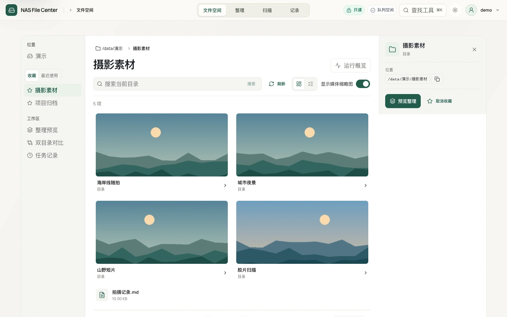

<details>
<summary>查看深色、网格、缩略图关闭和手机界面</summary>

#### 深色列表

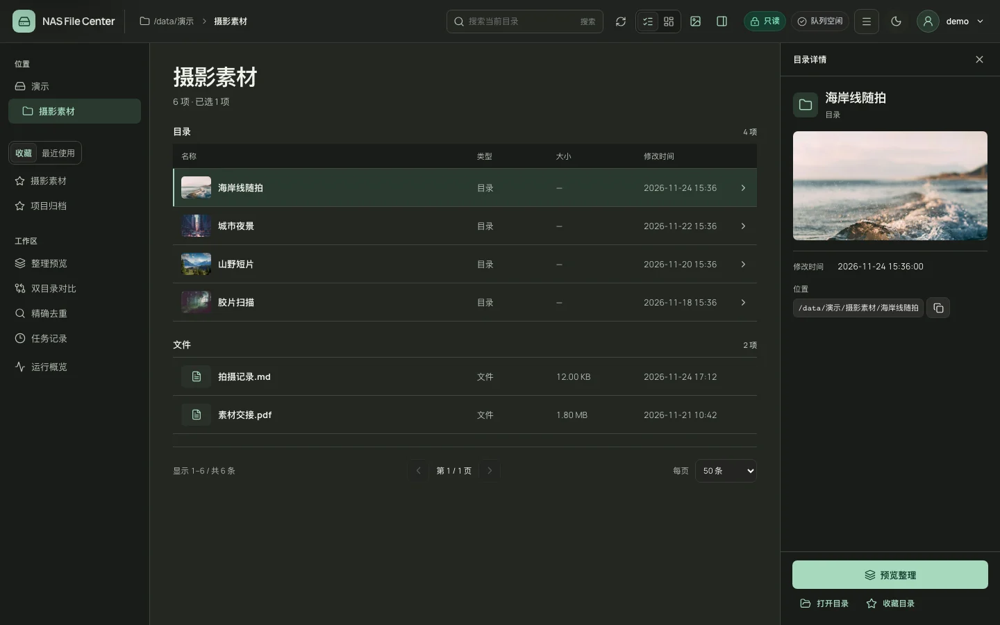

#### 网格和关闭缩略图后的列表

网格适合快速识别素材。关闭缩略图后，列表用类型图标标记目录和文件。

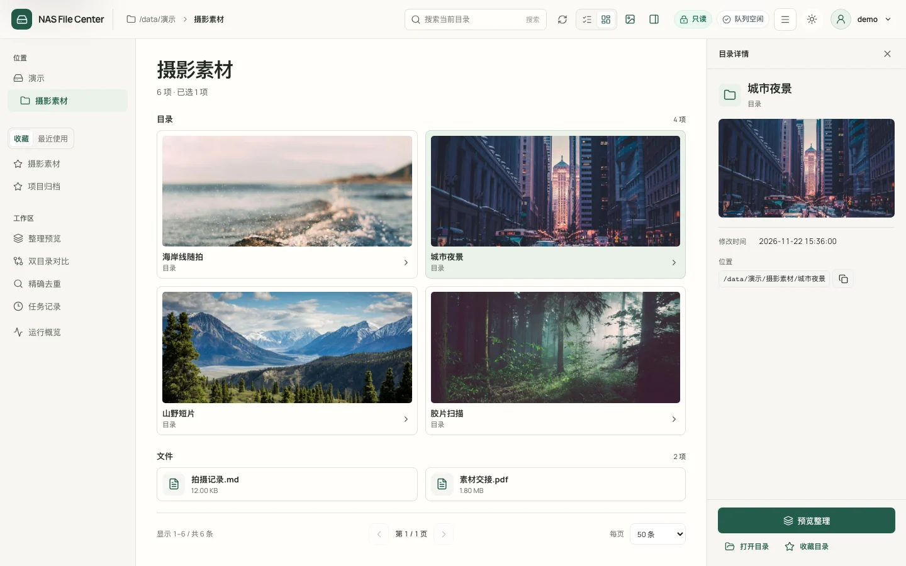

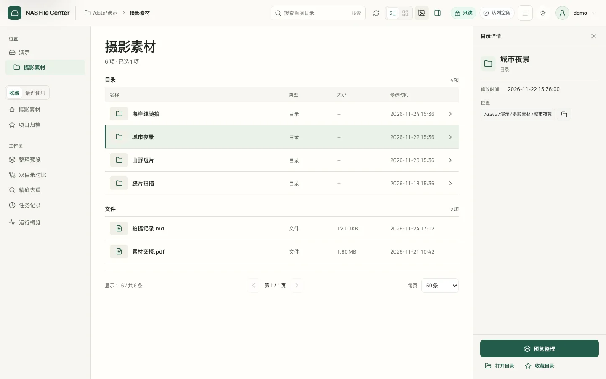

#### 手机文件列表和详情

<p>
  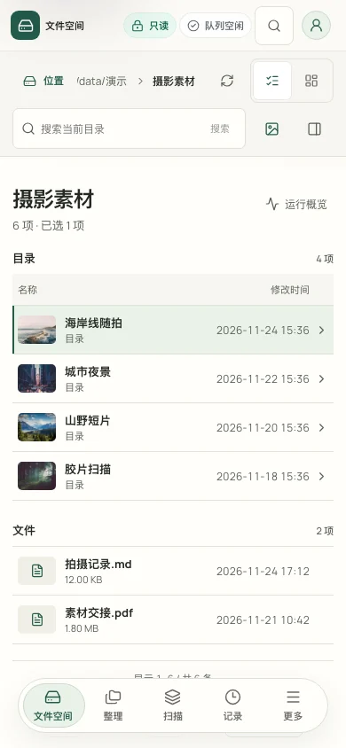
  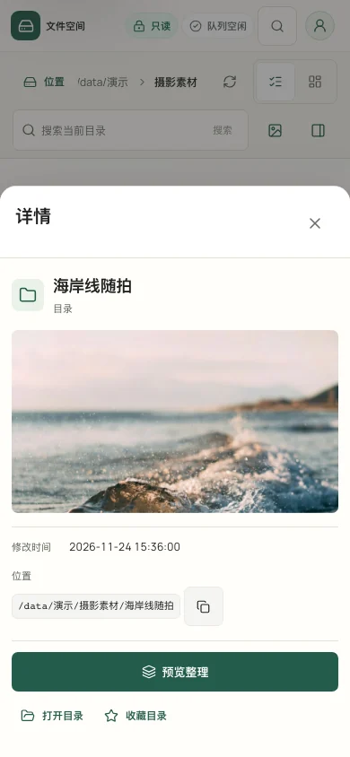
</p>

</details>

### 智能媒体整理

按目录查看可整理项和冲突。选择一项即可核对原路径、目标路径和分桶结果。

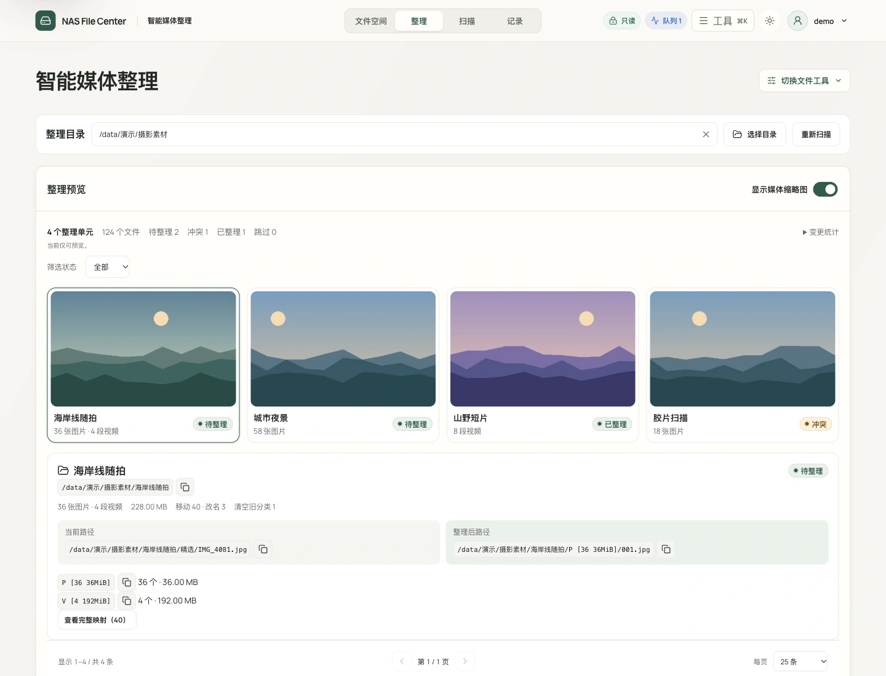

<details>
<summary>查看手机整理详情、工作流、任务中心和系统设置</summary>

### 手机整理详情

在手机上选中整理单元，可从详情抽屉查看路径变化和分桶结果。

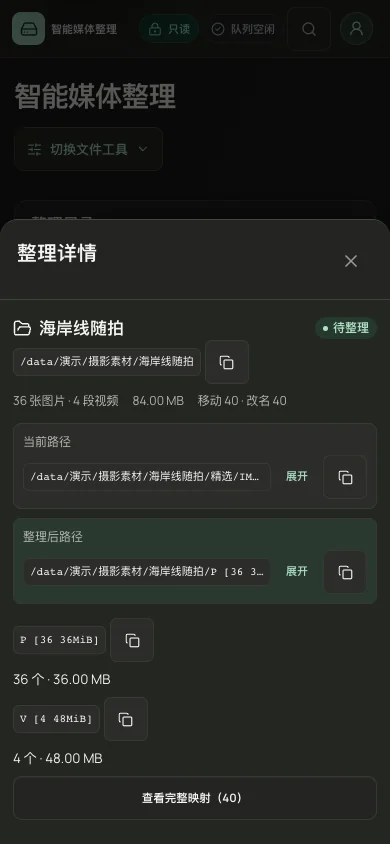

### 工作流中心

从扫描范围、文件筛选到重命名与移动，逐步核对归档规则并保存修订。

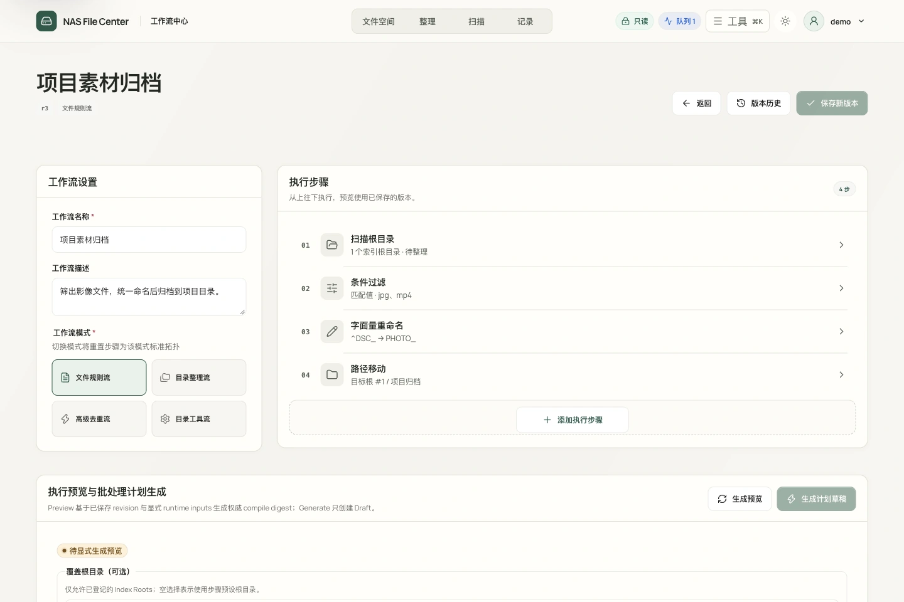

### 任务中心

查看 Worker 状态、实时进度和历史任务。桌面与移动端共用同一套操作入口。

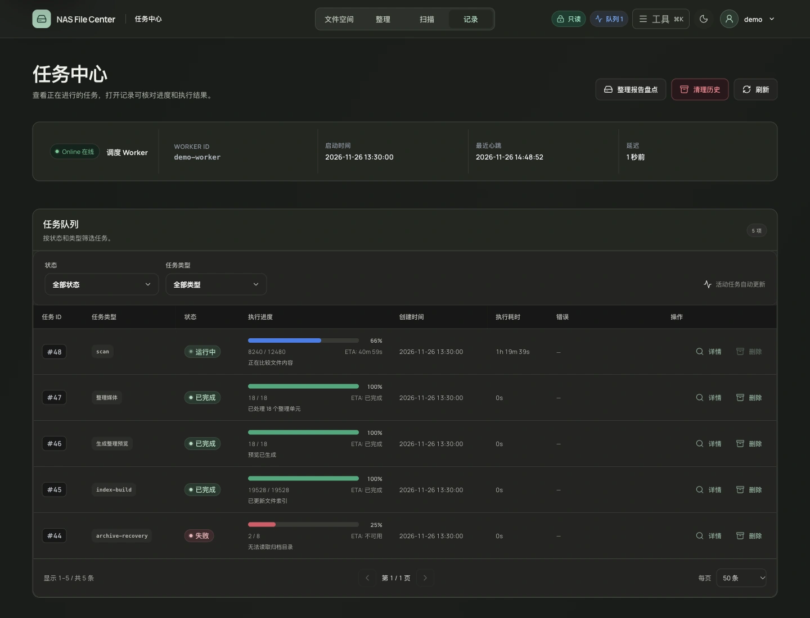

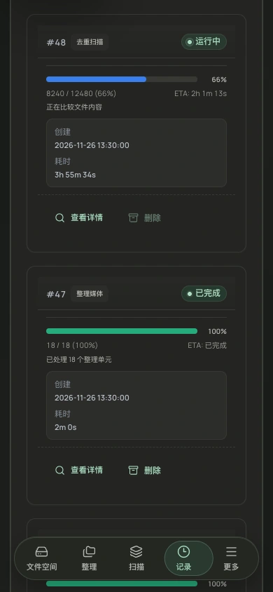

### 系统设置

各标签显示各自的设置项。「界面显示」控制当前浏览器的媒体缩略图偏好。

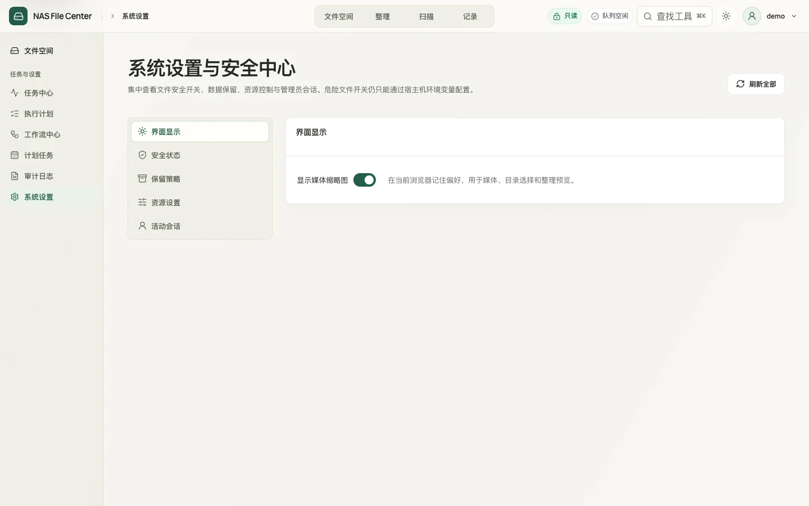

</details>

## 功能一览

| 功能 | 能做什么 |
| --- | --- |
| **文件空间与索引** | 浏览允许访问的目录，搜索当前目录，查看收藏与最近使用，并在列表和网格之间切换。文件索引页面可查看索引状态和更新进度。 |
| **智能媒体整理** | 递归预览整理单元，识别可归并的图片、视频与包装层，生成编号、分桶和路径映射。已整理目录、冲突和待确认项在预览中可见。 |
| **精确去重** | 通过 fclones 扫描重复组，支持多根目录与跨目录比较。可按目录优先级、时间或均衡保留策略生成计划。高级去重也可在受支持的文件系统上选择硬链接或 Reflink。 |
| **目录比较与文件巡检** | 按路径、文件名、主名或正则归一化匹配。用双目录差异定位缺失和不同项，用文件名巡检排查命名问题。 |
| **媒体与下载完整性** | 记录媒体探测和基线校验状态。通过 WebDAV 对比远端与 NAS 的相对路径和 SHA256，逐项定位缺失或内容差异。 |
| **批量重命名与目录整理方案** | 按正则、前后缀、补零或模板预览改名。可保存、克隆及导入导出整理方案，用于不同的目录统计和命名方式。 |
| **工作流与计划任务** | 组合扫描、筛选、改名、移动等步骤，保存修订并预览。计划任务支持索引更新、重复扫描、媒体校验和指定的工作流版本。 |
| **隔离区与压缩包恢复** | 检查隔离记录并恢复可恢复的文件。压缩包恢复可对支持的格式尝试提取，并区分已验证文件和未验证结果。 |
| **任务与安全设置** | 查看 Worker 心跳、任务状态、审计日志和会话。设置保留策略与资源限制，并切换浅色、深色及跟随系统主题。 |

### 媒体整理的默认布局

同一整理单元内，图片每桶最多 **200 张**，视频每桶最多 **50 个**。图片、视频混合时分别归入 `P`、`V` 桶，每个桶独立从 `001` 编号。符合条件的小型单类单元可直接在当前层编号。

例如，5 个文件在同一个作品目录时，混合整理的预览可以是：

```text
海岸线随拍/
├── P [3 12MiB]/
│   ├── 001.jpg
│   ├── 002.jpg
│   └── 003.jpg
└── V [2 96MiB]/
    ├── 001.mp4
    └── 002.mp4
```

桶名中的数量和大小取自实际文件。整理器会根据目录结构识别可去掉的包装层，并保留识别出的独立作品、分册或版本边界。目标重名和归属无法确认的情况可在预览中检查。

桌面支持浅色、深色和跟随系统主题。文件空间在打开存储根目录时按需加载白色机身的 3D 预览，鼠标在整张卡片内移动时可转动机身。触屏、启用减少动态效果或 WebGL 不可用时显示同一机身的静态渲染。

## 快速开始

### 1. 准备配置

准备一个允许应用管理的数据目录和一个独立的配置目录。下面以 Docker Compose 为例。

```bash
git clone https://github.com/JinHaocong/nas-file-center.git
cd nas-file-center
cp config.example.env .env
```

编辑 `.env`，把宿主机路径换成自己的路径，并设置首次登录使用的独立密码。可以先用一份小型演示目录体验只读预览。

| 配置项 | 用途 |
| --- | --- |
| `HOST_DATA_DIR` | 要管理的宿主机目录，容器内显示为 `/data`。 |
| `HOST_CONFIG_DIR` | SQLite 数据库、报告和迁移备份的持久化位置，挂载为 `/config`。API 与 Worker 共享此目录。 |
| `INITIAL_ADMIN_USERNAME`、`INITIAL_ADMIN_PASSWORD` | 首次初始化管理员。数据库已有用户后，重部署不会用环境变量覆盖账号密码。 |
| `DATA_MODE`、`ALLOW_MUTATION`、`ALLOW_DELETE` | 示例默认以 `ro`、`false`、`false` 启动。文件实际变更还需要相应的读写挂载和服务端权限。 |
| `ALLOWED_ROOTS` | 容器内允许访问的目录。可把范围缩小到需要管理的共享目录。 |
| `QUARANTINE_ROOT`、`PROTECT_LAST_FILE` | 隔离区位置和最后一份文件的保护策略。 |
| `SESSION_COOKIE_SECURE` | HTTPS 部署使用 `SESSION_COOKIE_SECURE=true`。仅在本地 HTTP 测试时设为 `false`，否则浏览器可能不会发送登录 Cookie。 |

### 2. 启动 API 和 Worker

使用仓库自带的 Compose 在本机构建。

```bash
docker compose up -d --build
docker compose ps
```

也可以使用已发布的镜像。新建本地 `compose.image.yaml`，为两个服务指定相同版本。

```yaml
services:
  api:
    image: kerwinjhc/nas-file-center:2.0.9
    platform: linux/amd64
  worker:
    image: kerwinjhc/nas-file-center:2.0.9
    platform: linux/amd64
```

```bash
docker compose -f compose.yaml -f compose.image.yaml up -d --no-build --pull always
```

默认 Web 端口为 `8080`，可用 `WEB_PORT` 调整。打开 `http://localhost:8080` 登录。容器的 HTTP 探活路径为 `/health`，页面上的 Worker 状态则反映后台进程能否处理任务。

### 3. 在 NAS 或 Komodo 上升级

1. 保留原 `/config` 挂载。数据库增量迁移在需要变更结构之前写入 `/config/backups/`。
2. 把 API 和 Worker 的镜像标签同时更新为目标版本，拉取镜像并重新部署。
3. 登录确认页面版本和 Worker 在线状态。整理规则更新后，从目标目录生成一份新预览。

在 Komodo 中配置 API 和 Worker 两个服务，共用 `/config` 和 `/data` 挂载。API 使用镜像默认启动命令，Worker 的启动命令为 `python -m app.worker`。以 Zoraxy 为例，可将反向代理和 API 接入同一外部 Docker 网络（例如 `nginx_network`），将自己的 HTTPS 域名（示例 `https://files.example.com`）转发到 `nas-file-center-api:8080`。Worker 无需对外暴露端口。

## 常用操作

### 浏览文件空间

| 想做什么 | 怎么操作 |
| --- | --- |
| **进入目录** | 从左侧「位置」或顶部路径进入指定目录。桌面单击选中，双击目录或选中后按 Enter 进入。手机点目录直接进入。 |
| **找当前目录里的文件** | 在顶部输入关键词，按 Enter 或点击「搜索」。可通过清除按钮返回完整列表。 |
| **核对文件或目录** | 在详情栏查看现有信息、复制完整路径。手机可用工具栏的详情按钮，或点文件打开详情。 |
| **看封面或切换密度** | 在顶部切换列表与网格，或直接用图片图标开关缩略图。 |
| **找全站工具** | 打开顶部工具菜单，或按 `Ctrl+K` / `⌘K`。从文件空间的「运行概览」可查看索引、扫描和任务摘要。 |

### 整理一个目录

1. 在文件空间选中目录，点击右侧「预览整理」，进入整理页后点击「预览」。也可以直接打开「智能媒体整理」，在目录选择器中选定目录后自动开始预览。
2. 按「待整理」「已整理」「冲突」等状态筛选。点开整理单元，核对分桶、源路径和目标路径。遇到冲突时，可在详情中查看具体原因。
3. 完成核对后，在允许执行的部署中确认整理。系统按当前预览中的可执行单元处理。
4. 在结果页或任务中心查看成功、跳过、冲突和失败。遇到文件或目录被改动时，重新扫描对应范围。

启用正式整理需要数据目录允许写入，并按执行入口开启 `ALLOW_MUTATION` 与 `ALLOW_DELETE`。只读部署也可以生成预览。

### 从云端复制到 NAS

在主导航打开「云端文件」，切换 OpenList 或 rclone，选中文件或目录后复制到 NAS 存放位置。页面直接查询两边的原生传输进度、单文件速度和历史记录。可以取消传输、删除已结束的记录，或打开对应服务的任务页。[部署配置](docs/webdav-download-verification.md#云端文件)

### 整理时回收下载附带文件

为 API 和 Worker 配置极空间官方 CLI、授权 profile 和目录映射后，智能媒体整理会在所选范围内单列待回收文件。适用于 Luolcy 和非 Luolcy 目录。 [配置示例](config.example.env)

管理员可在「系统设置 → 安全状态 → 极空间授权」绑定或重新授权。打开极空间授权页，选定设备并授权，再把一次性授权码填回设置页。使用网页授权时，API 与 Worker 需要挂载同一份只读 CLI 和私有授权卷。回收使用部署中配置的目录映射，极空间路径应对应容器的 `DATA_MOUNT`。

- 所选目录内，以 `.txt` 或 `.url` 结尾的普通文件都会列入回收预览，扩展名匹配不区分大小写。
- 在预览中查看文件名和回收原因，点「确认整理与回收」后由 Worker 送入极空间系统回收站。

### 扫描重复并生成去重计划

1. 从「精确去重」选择扫描目录，等待 fclones 生成重复组。
2. 查看候选文件、保留策略和预计可释放空间，按需修改待处理项。
3. 生成执行计划，依次完成冻结和校验。计划校验会重新核对实际文件，适用的去重操作会核验完整内容哈希。
4. 执行后查看审计记录与隔离区。支持恢复的隔离记录可以从隔离区操作。

### 调整缩略图和主题

- 在文件空间的工具栏使用缩略图开关，也可在「系统设置 → 界面显示」里切换「显示媒体缩略图」。偏好记在当前浏览器，适用于使用媒体缩略图的页面。
- 在顶部主题菜单切换浅色、深色或跟随系统。手机上的主题选项位于底部「更多」菜单。

### 查看后台任务和报告

- 从「任务中心」查看任务进度、失败原因和日志。扫描或整理在后台运行，可离开页面后再返回查看结果。
- 在「任务中心」查看智能整理报告盘点。删除任务时，满足安全条件的报告可由 Worker 回收。失败或中断任务的恢复资料会保留。
- 遇到任务长时间停在运行中时，检查 Worker 心跳、任务日志以及 SQLite 锁等待。[Worker 与 NAS 排障](docs/worker-restart-diagnosis.md)

## 架构与安全

```text
浏览器（React + TypeScript）
             │
        FastAPI 服务 ── SQLite 任务、计划与审计
             │                     │
        文件访问白名单         后台 Worker
                                   │
                    fclones 扫描 · ffprobe 探测 · 文件执行
```

- **扫描与执行分离。** fclones 负责发现重复，文件处置由应用的计划和 Worker 执行。
- **确认范围可追溯。** 写入计划和媒体整理使用冻结清单及文件身份校验。执行时检测路径越界、目标占用和源数据变化。
- **带边界的恢复。** 隔离、文件执行和后台任务分别记录恢复所需的信息。文件系统能力不足或校验冲突时，保留相关记录供核对。
- **配置由部署端控制。** `/data` 挂载选项、允许根目录和变更权限由宿主机配置。Web 界面可查看安全状态，并管理会话和审计保留策略。

## 本地开发

开发环境使用 **Python 3.12+**、**Node.js 22** 和 npm。需要实际运行重复扫描或媒体探测时，本机还应提供 `fclones` 和 `ffmpeg` / `ffprobe`。Docker 镜像已包含这些工具。

```bash
python3.12 -m venv .venv
source .venv/bin/activate
python -m pip install -e '.[test]'

mkdir -p config sample-data
export CONFIG_DIR="$PWD/config"
export DATA_MOUNT="$PWD/sample-data"
export ALLOWED_ROOTS="$DATA_MOUNT"
export QUARANTINE_ROOT="$DATA_MOUNT/.nas-file-center-trash"
export SESSION_COOKIE_SECURE=false
# 首次运行时，在当前 shell 另外设置 INITIAL_ADMIN_USERNAME 和 INITIAL_ADMIN_PASSWORD。
uvicorn app.main:app --host 127.0.0.1 --port 8080
```

在另一个终端使用相同的虚拟环境与环境变量运行 `python -m app.worker`。然后启动 Vite，在 `http://localhost:3000` 打开界面。Vite 会把 API 请求转发到本机的 FastAPI 服务。

```bash
cd frontend
npm ci
npm run dev
```

开发验证命令如下。后端测试使用独立配置和测试数据目录。

```bash
test_root=$(mktemp -d)
mkdir -p "$test_root/config" "$test_root/data"
CONFIG_DIR="$test_root/config" DATA_MOUNT="$test_root/data" \
  ALLOWED_ROOTS="$test_root/data" QUARANTINE_ROOT="$test_root/data/.trash" \
  python -m pytest

cd frontend
npm test
npm run typecheck
npm run build
```

## 进一步阅读

- [媒体整理报告、安全检查与恢复](docs/media-package-report-safety.md)
- [ZOS / FUSE 挂载兼容与能力验证](docs/media-package-zfuse-compat.md)
- [双目录差异](docs/directory-diff-v1.md) · [文件名巡检](docs/filename-quality-audit-v3.md)
- [OpenList / WebDAV 下载完整性校验](docs/webdav-download-verification.md)
- [压缩包恢复的支持格式、配置与限制](docs/archive-recovery.md)
- [第三方组件及许可声明](THIRD_PARTY_NOTICES.md)
